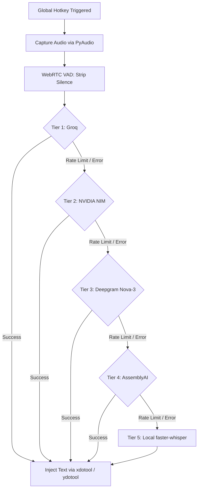

# LAZYTYPE ⚡🎙️

> **Ultra-low latency, system-wide speech-to-text dictation engine for Linux**  
> Hold a hotkey anywhere — speech instantly transcribes and injects into any application, terminal, browser, or editor with automatic multi-tier cloud and local fallback.

[](https://www.python.org/)
[-lightgrey.svg)]()
[](LICENSE)
[]()

---

## ⚡ Overview

**LAZYTYPE** gives you a seamless, always-on dictation experience across your entire Linux desktop without subscription paywalls or vendor lock-in. 

Press or hold your global hotkey (default: **Right Ctrl**), speak naturally, and your transcription is automatically filtered with WebRTC Voice Activity Detection (VAD) and typed directly into the active window at lightning speed.

### ✨ Highlights

- **Universal Hotkey Integration:** Works natively across X11 and Wayland (supporting GNOME Terminal, Alacritty, Kitty, VS Code, Chrome, etc.).
- **Unstoppable Multi-Tier Fallback Chain:** If your primary cloud provider hits rate limits or network issues, LAZYTYPE auto-cascades down the pipeline in milliseconds without interrupting your workflow.
- **Local Fallback Mode:** When completely offline or off-grid, falls back to a fast, local `faster-whisper` CPU engine.
- **Smart Voice Activity Detection (VAD):** Trims silence before sending audio, saving API quota and reducing latency.
- **Multiple UI Modes:**
  - **OSD Floating Bar & Tray:** Desktop floating status indicator + tray icon (Idle 🔴 → Recording 🟡 → Transcribing 🟢).
  - **Terminal TUI Dashboard:** Rich, real-time terminal UI (`lazytype --tui` / `voiceflow --tui`) for headless or minimalist setups.

---

## 🔄 Provider Fallback Pipeline



| Priority | Provider | Model | Latency | Free Quota |
|---|---|---|---|---|
| **1 (Default)** | **Groq** | `whisper-large-v3-turbo` | ~300ms | Generous free tier |
| **2** | **NVIDIA NIM** | `whisper-large-v3` | ~400ms | 1,000 free credits |
| **3** | **Deepgram** | `nova-3` | ~250ms | $200 free credit |
| **4** | **AssemblyAI** | `universal-2` | ~600ms | 100 hrs free |
| **5 (Offline)** | **Local Whisper** | `faster-whisper (base.en)` | ~800ms | Completely offline & free |

---

## 🚀 Quick Start

### 1. System Dependencies (Ubuntu / Debian)

```bash
sudo apt update
sudo apt install -y python3-pyaudio portaudio19-dev libevdev-dev xdotool ydotool wl-clipboard
```

> **Note on hotkey access:** LAZYTYPE reads global hotkeys using `evdev`. Make sure your user is in the `input` group:
> ```bash
> sudo usermod -aG input $USER
> # Log out and log back in, or run: newgrp input
> ```

### 2. Set Up API Keys

At minimum, get a free Groq API key from [console.groq.com](https://console.groq.com) and add it to your `~/.bashrc` (or `~/.zshrc`):

```bash
export GROQ_API_KEY="gsk_..."

# Optional fallback keys:
export NVIDIA_API_KEY="nvapi-..."
export DEEPGRAM_API_KEY="..."
export ASSEMBLYAI_API_KEY="..."
```

### 3. Installation

Clone and install using `uv` or `pip`:

```bash
git clone https://github.com/R-Hruthvik/LAZYTYPE.git
cd LAZYTYPE

# Using uv (recommended)
uv venv
source .venv/bin/activate
uv pip install -e .

# Or using standard pip
pip install -e .
```

### 4. Test Microphone & Provider

Run a 3-second diagnostic test to ensure audio recording and STT inference are functioning:

```bash
voiceflow --test
```

### 5. Launch

```bash
# Start background tray + floating OSD overlay:
voiceflow

# Or start the terminal TUI dashboard:
voiceflow --tui
```

---

## ⌨️ Hotkey Modes

| Mode | Key | Behavior |
|---|---|---|
| **Push-to-talk (Default)** | Hold `Right Ctrl` | Records while held down; transcribes and injects immediately on release |
| **Toggle** | Press `Right Ctrl` | Press once to start recording; press again to transcribe and insert |

Customize key bindings and preferences in `~/.config/voiceflow/config.toml`:

```toml
[general]
hotkey = "KEY_RIGHTCTRL"   # KEY_RIGHTALT, KEY_CAPSLOCK, KEY_F9, etc.
mode = "push_to_talk"      # "push_to_talk" | "toggle"

[audio]
vad_aggressiveness = 3     # 0 (least aggressive) to 3 (most aggressive silence filter)
sample_rate = 16000

[ui]
show_osd = true
show_tray = true
```

---

## 🖥️ Text Injection Compatibility

| Environment | Protocol | Injection Mechanism | Status |
|---|---|---|---|
| **GUI Terminal** (GNOME Terminal, Kitty, Alacritty) | X11 / Wayland | `xdotool` / `ydotool` | ✅ Direct keystroke simulation |
| **Code Editors** (VS Code, Cursor, Zed, Sublime) | X11 / Wayland | `xdotool` / `ydotool` | ✅ Direct keystroke simulation |
| **Browsers & Web Apps** (Chrome, Firefox, Slack) | X11 / Wayland | Active focus typing | ✅ Direct keystroke simulation |
| **Headless / SSH / Terminal fallback** | CLI | Clipboard (`wl-copy` / `xclip`) | ✅ Clipboard sync |

---

## 🧪 Running Tests

```bash
pytest tests/ -v
```

---

## 📄 License

This project is open-source under the [MIT License](LICENSE).
